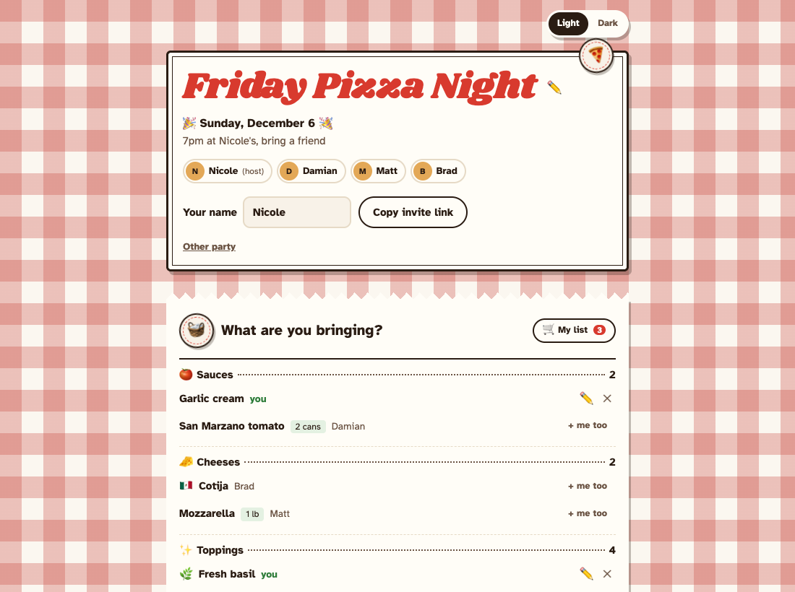
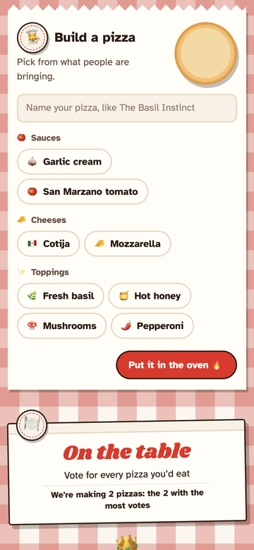
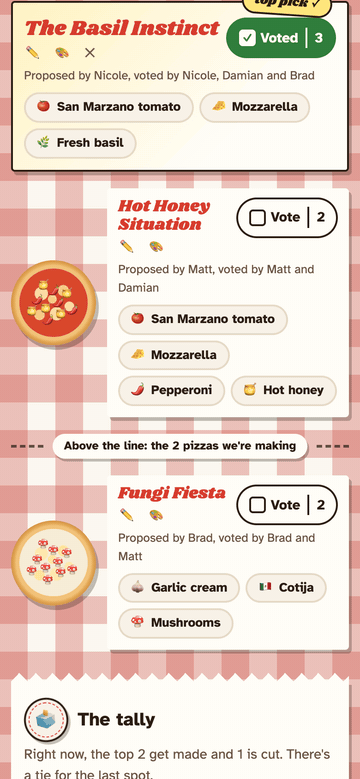
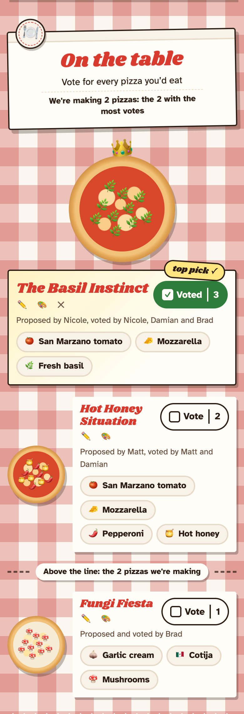
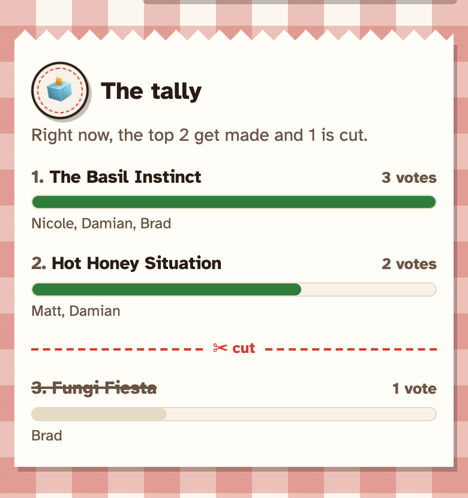
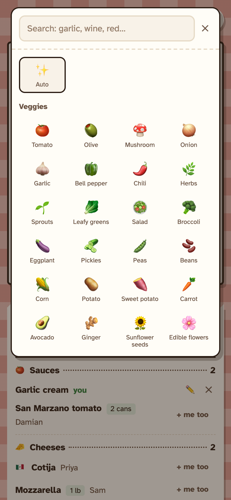
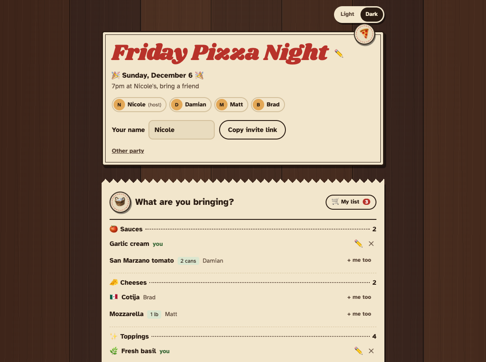

# 🍕 Pizza Party Planner

A tiny, free website for pizza-making parties. Send friends one link, and everyone signs in with Google, says what they're bringing, builds pizzas from what's actually coming, and votes on the best one.

**Live:** <https://nicoleyson.github.io/pizza-party-planner/>



| Build a pizza and watch it draw itself | One vote can move the cut line |
|---|---|
|  |  |

<details>
<summary>More screenshots</summary>

| On the table | The tally | Pick any emoji |
|---|---|---|
|  |  |  |



</details>

*Screenshots use demo mode with a made-up party.*

## What it does

**For guests**
- **Who's coming:** everyone who opens the party shows up at the top with their name and Google photo. The host gets a little "host" tag.
- **What are you bringing?** Add ingredients as a sauce, cheese, topping or other (dough, drinks…), with an optional amount and pizza icon. Fix the category or details later with ✏️, and remove them with ✕. If two people bring the same thing, it merges into one row, and anyone can tap **+ me too**.
- **🛒 My list:** a little button that opens your grocery run: just the things *you* signed up for, with amounts. Tick them off as you shop (ticks are saved only in your browser), or copy the list into your notes.
- **Dietary needs (optional):** a short list for allergies or restrictions, so nobody gets surprised.
- **Propose a pizza:** pick from the ingredients people are actually bringing, name it, and see it drawn live. 🎨 changes the sauce color and how much cheese there is. Anyone can rename a pizza.
- **Vote:** tap Vote on every pizza you’d eat, one vote per person per pizza. The leader gets a 👑.
- **Pizza goal:** the host can set how many pizzas you're making (✏️ next to the party name). A line on the table marks the ones with enough votes to get made.

**For hosts**
- **Host a new party:** each party gets its own secret invite link.
- ✏️ edits the party name, when/where, and the **party date**.
- **📅 Party date (optional):** after midnight at the end of that day, the party wraps up. The page becomes a read-only keepsake: nobody can add, change, vote or join, and the database rules enforce it. To reopen it, the host changes the date or clears it. Parties without a date stay open, just like before.
- **Cohosts (optional):** in ✏️, tick friends who've joined to make them cohosts. They can change the party's name, date, pizza goal and guest list too, and get a "cohost" tag. Only you can pick or remove cohosts, and the party stays yours.
- **🔒 Guest list:** optionally make a party invite-only, so only the Google emails you list can open it, even with the link. If people have already joined, you get a heads-up with their names before anyone is locked out.
- Only people on your **hosts** list can create parties. Everyone else can join parties they're invited to, and gets a friendly "not authorized to host" message if they try to start one.

**How it's built:** plain HTML/CSS/JS with no build step. It's hosted free on **GitHub Pages**, with data and Google sign-in from **Firebase** on the free Spark plan (no credit card needed).

## Privacy

- Each party lives behind a secret code in its invite link (`…/pizza-party-planner/#pepperoni-k3x9q2mf7a`). The part after `#` is never sent to GitHub, the code isn't in the repo, and the database refuses to list parties, so codes can't be found or guessed.
- Other guests see your **name and Google photo**, never your email. The guest list is only visible to that party's host.
- As the Firebase project owner, you can see everyone who has signed in under Authentication → Users.

## Set it up yourself

You need a Google account (for Firebase) and a GitHub account.

### 1. Firebase (about 10 minutes)

1. Go to <https://console.firebase.google.com> and create a project (Google Analytics: off).
2. **Realtime Database** → **Create database** → any location → **Start in locked mode**.
3. **Rules** tab: paste in [`database.rules.json`](database.rules.json), then click **Publish**.
4. **Authentication** → **Sign-in method** → enable **Google**. Leave every other provider off.
5. **Add yourself as a host.** In the database's **Data** tab, add a `hosts` key at the top level. Under it, add one entry per host: their Google email in lowercase with every `.` changed to `,`, set to `true` (boolean, no quotes). For example, `matt.lee@gmail.com` becomes `matt,lee@gmail,com: true`. Add more hosts the same way at any time. Nobody can add themselves from the website.
6. **Project settings → Your apps** → add a **Web app**. Copy its config values; you'll need them below.

### 2. Run it on your computer

```bash
cp config.example.js config.js   # then fill in your values from step 6
python3 -m http.server 8765
```

Open <http://localhost:8765>. `config.js` is gitignored, so your keys and project details never end up in the repo.

Without a `config.js`, the site runs in **demo mode**: no sign-in, and data saved only in your own browser. That's handy for trying out the design.

Already have a `config.js` and want to test without touching real parties? Open <http://localhost:8765/?demo>. The `?demo` switch only works on your own computer (localhost), never on the live site.

The **Light / Dark** switch at the top right picks the look. Light is the default, whatever your device is set to; Dark is remembered in that browser once you pick it.

To run the tests (Node 20 or newer, no installs needed):

```bash
npm test
```

To test the database rules exactly as Firebase applies them, run them against the Firebase emulator, an offline copy of the database on your computer that never touches the live one. It needs Java (`brew install openjdk`) and downloads Google's `firebase-tools` the first time:

```bash
npm run test:rules
```

It checks that parties made before party dates work as before, that a party locks after its date and the host can reopen it, that nobody can change someone else's things, and that invite-only parties stay private. Run it after any change to `database.rules.json`, before publishing the rules.

To click through the page itself, the way a guest, the host and a cohost would, run:

```bash
npm run test:e2e
```

It opens the site in a hidden Chrome window in demo mode, so it never signs in or touches real parties. It brings ingredients, builds a pizza, votes and checks the cut line moves, picks a cohost, checks a finished party is read-only until the host reopens it, and loads a party saved by an older version. It needs Google Chrome and takes a few seconds. Run it before pushing changes to the page.

### 3. Publish on GitHub Pages

1. Push this folder to a GitHub repo.
2. Repo → **Settings → Secrets and variables → Actions** → add four repository secrets from your Firebase web config: `FIREBASE_API_KEY`, `FIREBASE_APP_ID`, `FIREBASE_PROJECT_ID` and `FIREBASE_DATABASE_URL`.
3. Repo → **Settings → Pages** → Source: **GitHub Actions**.
4. Firebase → **Authentication → Settings → Authorized domains** → add `<your-username>.github.io`, or Google sign-in won't work on the live site.

Every push to `main` runs the tests, builds `config.js` from the secrets, and publishes the site ([`.github/workflows/pages.yml`](.github/workflows/pages.yml)) at `https://<your-username>.github.io/<repo-name>/`.

> The Firebase web config isn't truly secret: the live site has to send it to every visitor's browser so it can talk to Firebase. Keeping it out of the repo stops it showing up in code search and secret scanners, and lets anyone reuse this repo with their own project. What actually protects your data is the database rules.

## Hosting a party

1. Open the site, sign in, and fill in **Host a new party** with a name and when/where.
2. Click **🔗 Copy invite link** and send it to your group chat.
3. Optional: **🔒 Guest list** → add friends' Google emails → turn on **Invite-only**.

The invite link works like a password, so only share it with friends. If it leaks, turn on invite-only or host a new party.

> **Updating from an older version?** Cohosts need the latest rules too, and so do party dates and party mode. Paste the new [`database.rules.json`](database.rules.json) into Firebase → Realtime Database → **Rules** and click **Publish** *before* you push the site. The old rules don't know about party dates, so creating or editing a party with a date would fail until they're updated. Party mode stays switched off until then (the page just doesn't show it), and setting a party mode time would fail. The new rules work fine with the old site, and existing parties aren't affected: the party mode rules only restrict parties that have a party mode time.

To clean up old parties: Firebase → Realtime Database → **Data** → `parties` → delete the ones you don't need.

## Security checklist

Already handled:

- **Database rules** ([`database.rules.json`](database.rules.json)):
  - Nothing can be read or written without signing in with a verified Google account.
  - Only hosts can create parties.
  - People can only change their own things. The exceptions, by design: any guest can rename a pizza or change its look.
  - Each person gets one vote per pizza.
  - Nobody can list parties, add themselves as a host, or store data under a party that doesn't exist.
  - Everything saved is length-limited and checked.
- **No keys in the repo:** `config.js` is gitignored, and the deploy builds it from repo secrets.
- **Content Security Policy** (in `index.html`): the page only runs code from this site and Google's Firebase servers, and only connects to Firebase and Google sign-in.
- **Escaping:** anything people type is escaped before it's shown, icons must come from a fixed list, and photos must be real Google profile photo links.
- **No referrer:** invite codes never leak to other sites through links.

Worth checking in Firebase and Google Cloud:

1. **Sign-in providers** (Authentication → Sign-in method): only **Google** should be enabled.
2. **Authorized domains** (Authentication → Settings):
   - Keep `localhost` for local testing.
   - Keep `<project>.firebaseapp.com`: Google sign-in runs there.
   - Keep your `<username>.github.io`.
   - `<project>.web.app` is optional.
3. **Lock the API key to your sites** (recommended):
   1. Open <https://console.cloud.google.com/apis/credentials>, signed in with the same Google account, and pick your Firebase project in the project picker at the top.
   2. Under **API Keys**, click **Browser key (auto created by Firebase)**.
   3. **Application restrictions** → **Websites**, then add:
      - `https://<username>.github.io/*`
      - `https://<project>.firebaseapp.com/*` (required, or Google sign-in breaks)
      - `http://localhost:8765/*` (for local testing)
   4. Click **Save**. It can take a few minutes to apply. Then sign in on the live site once to confirm it still works.
4. **Stay on the Spark plan:** if anyone ever floods the database, it pauses at the free limits instead of billing you.

## Files

| File | What it is |
|---|---|
| `index.html` | The page, including its Content Security Policy |
| `app.js` | Sign-in, the party screens, saving and live updates |
| `lib.js` | Small helpers: party codes, escaping, grouping ingredients, ranking pizzas |
| `night.js` | Party mode: the host preview, game plan, pizza count, extra pizzas, prep list by day with notes and tasks, oven timers, ratings and awards |
| `pie.js` | The pizza drawings: sauce colors, cheese, topping dots and icons |
| `style.css` | The look: a checkered tablecloth with paper order tickets on it, and a walnut table in dark mode (follows your device setting) |
| `theme.js` | The Light / Dark switch. Loads first so the page never flashes the wrong theme |
| `morph.js` | Updates lists in place when friends change things, so the page doesn't jump or lose what you're typing |
| `config.example.js` | Template for your `config.js` (Firebase settings) |
| `database.rules.json` | Firebase security rules: paste these into the Rules tab |
| `tests/` | `npm test`: helpers, drawings, and checks that the rules stay strict. `npm run test:rules`: the rules against the Firebase emulator. `npm run test:e2e`: the page itself, in a hidden Chrome |
| `firebase.json` | Only tells the emulator where the rules are (`npm run test:rules`) |
| `.github/workflows/pages.yml` | Tests, builds `config.js` from secrets, and deploys |
| `docs/screenshots/` | The pictures in this README (not part of the site) |
